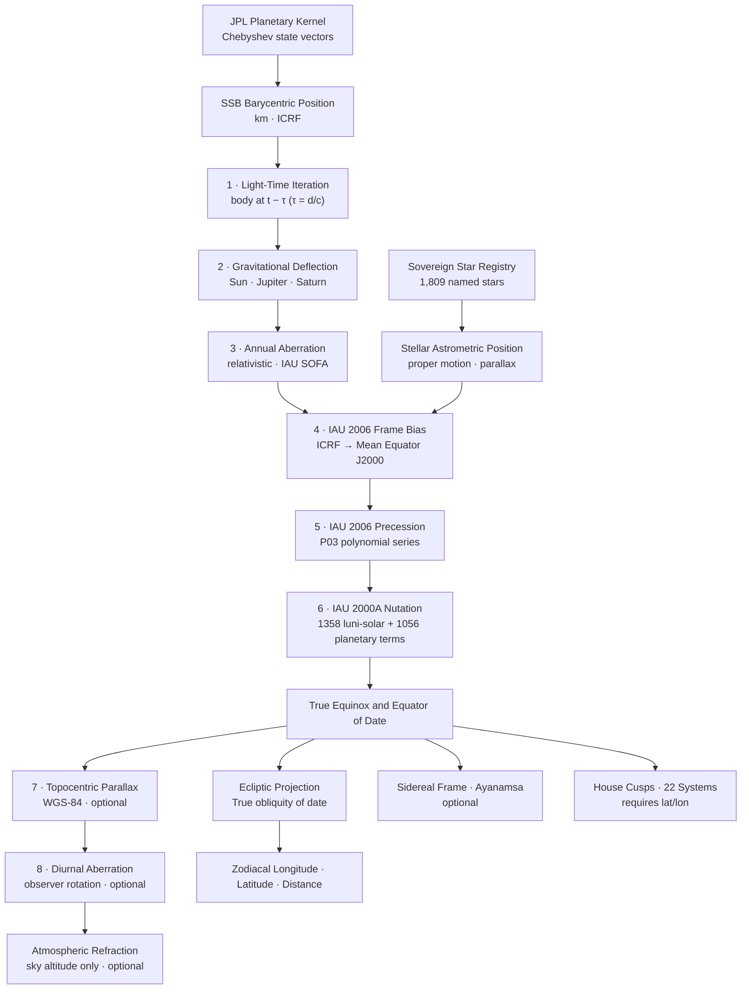

# Moira

**Astronomy-First Ephemeris and Astrology Computation Engine**

[](https://www.python.org/downloads/)
[](https://opensource.org/licenses/MIT)
[](https://pypi.org/project/moira-astro/)
[](#native-c-performance)
[](#validation-evidence-and-light-box-conformance)
[](wiki/03_validation/LIGHT_BOX_CURRENT_STATUS.generated.md)
[](https://naif.jpl.nasa.gov/naif/index.html)
[](llms.txt)
[](https://doi.org/10.5281/zenodo.19152528)

Moira is a sovereign, astronomy-first computation engine built for transparent astrological derivation, reproducible chart reduction, and an inspectable calculation chain from physical ephemerides to astrological outputs. Grounded in JPL DE441/DE440 state vectors, IAU 2000A/2006 precession-nutation models, ERFA/SOFA-aligned astrometry, and Gaia DR3-linked stellar catalogs, Moira pairs a zero-dependency Python orchestration and policy layer with a required C++17 numerical extension (`_moira_native`, compiled via `pybind11`).

Where conventional astrology libraries return terminal numbers from opaque defaults, Moira operates as a **Light Box**: computation stages are named and individually toggleable, doctrinal and source variants are explicit parameters rather than silent assumptions, and validation is maintained as version-bound, replayable evidence.

---

## Table of Contents

- [Why Moira & The Light Box Doctrine](#why-moira--the-light-box-doctrine)
- [Requirements and Installation](#requirements-and-installation)
- [Quick Start](#quick-start)
- [The Reduction Pipeline](#the-reduction-pipeline)
  - [Worked Example: Mars at 2000-01-01 12:00 UT1](#worked-example-mars-at-2000-01-01-1200-ut1)
  - [Pipeline Controls](#pipeline-controls)
- [What Moira Computes](#what-moira-computes)
  - [Positions and Celestial Catalogs](#positions-and-celestial-catalogs)
  - [Chart Architecture and Traditional Western](#chart-architecture-and-traditional-western)
  - [Predictive and Time-Lord Techniques](#predictive-and-time-lord-techniques)
  - [Vedic / Jyotish Suite](#vedic--jyotish-suite)
  - [Phenomena, Visibility, and Locational Astronomy](#phenomena-visibility-and-locational-astronomy)
- [REST API Server (`moira_server`)](#rest-api-server-moira_server)
- [Kernel Setup and Small-Body Archives](#kernel-setup-and-small-body-archives)
  - [Planetary Kernels (JPL SPK)](#planetary-kernels-jpl-spk)
  - [Kernel Manager GUI, CLI, and Custom DAF Writer](#kernel-manager-gui-cli-and-custom-daf-writer)
  - [Small-Body Catalogs (Asteroids and Comets)](#small-body-catalogs-asteroids-and-comets)
- [Data Inventory](#data-inventory)
- [Native C++ Performance](#native-c-performance)
- [Validation Evidence and Light Box Conformance](#validation-evidence-and-light-box-conformance)
- [AI and LLM Visibility](#ai-and-llm-visibility)
- [Project Documentation and Artifact Governance](#project-documentation-and-artifact-governance)
- [License](#license)

---

## Why Moira & The Light Box Doctrine

Astronomy is the foundation. Astrology is the purpose. Validation is the proof. Visibility is the doctrine.

| Pillar | What Moira Guarantees |
| :--- | :--- |
| **Sovereign Astronomical Substrate** | Direct native C++17 SPK/DAF reading of published JPL DE441/DE440/DE430 Chebyshev records and Type-13 Hermite small-body shards. No `jplephem`, Swiss Ephemeris, or third-party runtime wrapper. |
| **Light Box Inspectability** | Every major reduction stage—light-time iteration, gravitational deflection, relativistic aberration, IAU 2006 frame bias, P03 precession, IAU 2000A nutation, WGS-84 topocentric parallax, and refraction—is exposed as a typed breakdown or `ComputationTruth` receipt. |
| **Explicit Doctrinal Policy** | Competing classical and modern traditions (house polar fallbacks, sect horizon conventions, Egyptian vs. Ptolemaic bounds, BPHS vs. Saravali vs. Jaimini profile lineages, Addey harmonic orbs) are represented by immutable policy objects and source-cited receipts rather than silent defaults. |
| **Zero-Dependency Base Runtime** | Base `moira-astro` requires only the Python standard library plus its compiled `_moira_native` extension. Optional FastAPI transport (`moira-astro[server]`) and lunar-graze tooling (`moira-astro[lunar-graze]`) live behind strict feature boundaries. |
| **Audit-Ready Conformance** | Across `1,252` canonical public calculations in `150` families, `100%` of `P0` production-user calculations (`172 / 172`) and `210` total canonical surfaces are governed by `64` exact-source replay contracts under [`LIGHT_BOX_CURRENT_STATUS.generated.md`](wiki/03_validation/LIGHT_BOX_CURRENT_STATUS.generated.md). |

**Who It Is For:** Developers, ephemeris engineers, historians of astronomy/astrology, and researchers who require a programmable, audit-grade engine for reproducible pipelines and rigorous comparison against primary texts and physical oracles.

**What It Is Not:** Moira is not a consumer UI application, not a thin wrapper over opaque compiled stacks, and not convenience-first text generation without mathematical traceability.

---

## Requirements and Installation

- **Python:** `>=3.10` (`3.10`–`3.14` supported; Python `3.14` is the canonical CI baseline).
- **Native extension:** Installed automatically from published platform wheels, or compiled from source via a C++17 compiler, `cmake >= 3.24`, and `pybind11 >= 2.12`.
- **Planetary kernel:** A JPL DE-series `.bsp` kernel (`de440.bsp`, `de441.bsp`, or `de430.bsp` — downloaded separately; see [Kernel Setup](#kernel-setup-and-small-body-archives)).

```bash
# Standard engine install (uses a published wheel when available)
pip install moira-astro

# With the FastAPI REST server (FastAPI, Starlette, Uvicorn, Pydantic)
pip install "moira-astro[server]"

# With Lunar Graze support (spiceypy, laspy, requests)
pip install "moira-astro[lunar-graze]"
```

> [!NOTE]
> This README documents the `6.10.2` patch baseline. The PyPI badge identifies the latest packaged release; features merged after that release require a source checkout until the next version is published.

---

## Quick Start

Moira initializes cleanly even before a planetary kernel is configured. Kernel-dependent calls (such as `m.chart()`) raise an explicit `MissingEphemerisKernelError` with remediation instructions until a kernel is present in `kernels/` or `~/.moira/kernels/`.

```python
from datetime import datetime, timezone
from moira import HouseSystem, Moira
from moira.facade import planet_reduction_breakdown_at
from moira.houses import house_of
from moira.patterns import find_all_patterns

m = Moira()
dt = datetime(2000, 1, 1, 12, 0, tzinfo=timezone.utc)

# 1. Planetary chart reduction
chart = m.chart(dt)
print(f"Sun:  {chart.planets['Sun'].longitude:.6f} deg ({chart.planets['Sun'].sign})")
print(f"Moon: {chart.planets['Moon'].longitude:.6f} deg ({chart.planets['Moon'].sign})")

# 2. House cusps and placement (Placidus, London)
houses = m.houses(
    dt,
    latitude=51.5074,
    longitude=-0.1278,
    system=HouseSystem.PLACIDUS,
)
sun_house = house_of(chart.planets["Sun"].longitude, houses)
print(f"ASC: {houses.asc:.4f} deg | MC: {houses.mc:.4f} deg | Sun House: {sun_house}")

# 3. Aspect pattern detection
for pattern in find_all_patterns(chart.longitudes()):
    print(f"{pattern.name}: {', '.join(pattern.bodies)}")

# 4. Light Box inspectability: per-stage astrometric breakdown at JD_UT1 2451545.0
breakdown = planet_reduction_breakdown_at("Mars", 2451545.0)
print(f"Mars apparent longitude: {breakdown.final_longitude:.6f} deg")
print(f"Light-time delay (days): {breakdown.light_time_days:.6f}")
```

---

## The Reduction Pipeline



### Worked Example: Mars at 2000-01-01 12:00 UT1

This snapshot is reproduced by `planet_reduction_breakdown_at("Mars", 2451545.0, reader)` with the admitted DE441 kernel. The input is `JD_UT1 2451545.0`; it is about 63.829 seconds after the exact J2000.0 TT epoch and is therefore not labelled as exact J2000.0.

**Time:** `JD_UT1 2451545.000000` → `JD_TT 2451545.000739` ($\Delta T = +63.829\text{ s}$)

| Stage | Operation | Engine receipt | Longitude contribution |
| :---: | :--- | :--- | ---: |
| 0 | **Geometric geocentric** | SSB-to-Mars minus SSB-to-Earth; $\lambda = 327.975456^\circ$; distance = 276,697,408.4 km | reference |
| 1 | **Light-time iteration** | $\tau = 0.010683\text{ days} = 15.383\text{ min}$ | $-15.762371^{\prime\prime}$ |
| 2 | **Gravitational deflection** | Sun, Jupiter, and Saturn | $-0.003057^{\prime\prime}$ |
| 3 | **Annual aberration** | Earth barycentric velocity; relativistic | $-14.069158^{\prime\prime}$ |
| 4 | **IAU 2006 frame bias** | ICRF to dynamical mean J2000 | $+0.000300^{\prime\prime}$ |
| 5 | **IAU 2006 precession** | P03; mean equator/ecliptic of date | $+0.006571^{\prime\prime}$ |
| 6 | **IAU 2000A nutation** | $\Delta\psi = -13.932004^{\prime\prime}$; $\Delta\varepsilon = -5.769413^{\prime\prime}$ | $-13.932004^{\prime\prime}$ |
| 7–8 | **Topocentric parallax and diurnal aberration** | disabled for this geocentric example | $0$ |

**Final position: Aquarius 27° 57′ 48″** · $\lambda = 327.963300^\circ$ · $\beta = -1.067779^\circ$ · distance = $1.849688\text{ AU}$ · speed = $+0.775674^\circ/\text{day}$

**Total visible reduction from the geometric J2000-ecliptic reference to the final true-of-date ecliptic longitude: $-43.759719\text{ arcseconds}$.**

The stage contributions above come from the typed reduction receipt. They should not be reconstructed by subtracting unrelated coordinate frames or by treating `apparent=False` as "no frame transformation."

### Pipeline Controls

Selected correction policies can be toggled via `planet_at()`. The table below shows the measurable effect of disabling each exposed policy in this `JD_UT1 = 2451545.0` Mars snapshot.

| Parameter | Default | Effect on snapshot longitude | Function |
| :--- | :--- | :--- | :--- |
| `apparent=True` | `True` | Full pipeline active | `planet_at()` |
| `apparent=False` | — | Omits light-time, deflection, and aberration while retaining the declared ecliptic-of-date frame and nutation policy. $\Delta = \mathbf{+29.835\text{ arcsec}}$ | `planet_at()` |
| `aberration=False` | — | Aberration stage skipped. $\Delta = \mathbf{+14.069\text{ arcsec}}$ | `planet_at()` |
| `grav_deflection=False` | — | Deflection stage skipped. $\Delta = \mathbf{+0.003\text{ arcsec}}$ | `planet_at()` |
| `nutation=False` | — | Nutation skipped; mean equinox used. $\Delta = \mathbf{+13.932\text{ arcsec}}$ | `planet_at()` |
| `observer_lat/lon` | `None` | When supplied together, adds WGS-84 topocentric parallax and observer-rotation diurnal aberration; the effect is body-, location-, and epoch-dependent. | `planet_at()` |
| `refraction=True` | `True` | Applies the declared pressure, temperature, and humidity model to geometric sky altitude. | `sky_position_at()` |
| `delta_t_policy` | `None` | Controls UT → TT conversion branch (IERS tables, polynomial, hybrid physical). | both |

---

## What Moira Computes

### Positions and Celestial Catalogs

- **Planets and luminaries** — Geocentric and topocentric reduction with iterative light-time, annual aberration, multi-body relativistic deflection (Sun, Jupiter, and Saturn, excluding the target body), IAU 2006 frame bias, and WGS-84 topocentric parallax.
- **Received-light cone (`light_cone`)** — Explicit comparison of apparent observed ecliptic positions (at photon emission epoch $t - \tau$) against instantaneous geometric positions (at $t$), exposing one-way light travel time, emission Julian Date, and angular displacement.
- **Fixed stars** — Sovereign registry of 1,809 named stars with 3D proper motion, annual parallax, epoch propagation, and Stellar Quality classification. Audited anchor residual against SOFA/ERFA: `0.00048` arcseconds (J1000–J3000).
- **Variable and multiple star systems** — Phase and magnitude engine for eclipsing binaries and intrinsic variables (including a dedicated Algol API); Keplerian orbital mechanics for visually resolvable binary pairs (Sirius AB, Alpha Centauri AB) across `VISUAL`, `WIDE`, `SPECTROSCOPIC`, and `OPTICAL` system classes.
- **Deep-sky coordinate anchors** — A bundled, release-bound selection of 60 galaxies, nebulae, star clusters, compact objects, stellar remnants, and confirmed exoplanet host stars. Extended objects are represented by sourced SIMBAD ICRS/J2000 catalog centers rather than point-mass claims; host-star positions delegate to the sovereign star registry.
- **Typed cosmic references and galactic frames** — Full equatorial-to-galactic transforms, the legacy five-point compatibility table, and 12 fixed ICRS/J2000 directions kept in three explicit classes: physical objects, coordinate landmarks, and declared proxies (keeping the formal supergalactic origin distinct from the legacy Virgo/M87 astrological SGC, and exposing selected cluster anchors for broad structures such as the Great Attractor and Shapley Concentration).
- **Position-capable asteroid ephemeris** — Two layers:
  1. **Wheel catalog (`moira-asteroids-wheel` release `2026.08.14.1`):** 25 named bodies (classical four, named Centaurs including Chiron, named TNOs, and selected others) bundled as one Type-13 shard so Chiron and the locked roster compute immediately after `pip install` plus a planetary kernel.
  2. **External archive (release `2026.10.10.1`):** 11,223 selected asteroids in release `2026.10.10.1` (449 Type-13 SPK shards from JPL Horizons, a 10-day / 7-node base with certified adaptive apsidal sampling for 59 audited bodies, manifest-discovered under any kernel search root). The wheel also carries the matching 11,223-body canonical identity registry (names only, no positional vectors). Separate from the positional shards, Moira bundles the Proper25/PDS asteroid-family membership catalog (342 families, 200,726 unique numbered asteroids, 221,095 membership rows).
- **Numbered periodic comets** — 497 comets (1P/Halley through 516P) in immutable external release `2026.10.10.1`, generated from JPL Horizons as 20 sharded Type-13 kernels with certified adaptive apsidal sampling for all 497 bodies, manifest-declared coverage, canonical numbered designations (`"1P/Halley"`), and curated family-scoped short aliases (`comet:` qualifier supported on unified chart surfaces).
- **Lunar nodes and planetary apsides** — True Node, Mean Node, Mean Lilith, True Lilith, and osculating/geometric orbital nodes and apsides for planetary bodies.
- **Uranian / Hamburg School bodies** — Source-orbit, apparent geocentric positions for the 8 Hamburg hypothetical bodies (Cupido through Poseidon; Neely 1980 elements) plus separately sourced Transpluto (Sevin/Strubell 1952 elements), with latitude, distance, and signed motion.

### Chart Architecture and Traditional Western

- **House systems** — 22 systems including Placidus, Koch, Regiomontanus, Campanus, Morinus, Porphyry, Whole Sign, Equal, Alcabitius, APC, Krusinski-Pisa-Goelzer, Pullen Sinusoidal Delta/Ratio, and Sunshine. Includes branch-aware high-latitude doctrine where admitted, explicit polar fallback policy receipts, 3D house-boundary geometry curves, and `house_of` placement lookups.
- **Aspects and motion witness** — 46 zodiacal aspects covering the complete admitted minor-aspect families, a shared alias registry, and applying/separating/stationary signed motion witnesses. Quindecile remains 24° and Tao remains 165°. Includes declination parallels and contra-parallels, antiscia and contra-antiscia, exact partile (`is_partile`) and orbed platic (`is_platic`) status markers, and geometric aspect strength.
- **Aspect patterns and Jones chart shapes** — 21 multi-body configurations (T-Square, Grand Trine, Grand Cross, Yod, Kite, Mystic Rectangle, Grand Sextile, Thor's Hammer, Boomerang Yod, and more) plus all 7 Marc Edmund Jones temperament chart shapes with computation truth receipts.
- **Planet-first stelliums** — Explicit Strict (four-planet) and Broad (three-planet) core counts, independent sign/house/total-span evidence, and associated bodies that attach without manufacturing a cluster. See [`STELLIUM_ANALYSIS_STANDARD.md`](wiki/02_standards/STELLIUM_ANALYSIS_STANDARD.md).
- **Midpoints** — Full midpoint matrix, midpoint trees, 90°/45°/22.5° dial projections, and planetary pictures.
- **Traditional dignities and almutens** — Domicile, exaltation, triplicity (Dorothean/Ptolemaic diurnal/nocturnal), Egyptian/Ptolemaic/Chaldean terms, face, sect, hayz, Reception, and Almuten Figuris.
- **Arabic Parts (Lots)** — 512 lot definitions with dependency graphs, diurnal/nocturnal reversal policies, and condition profiling.
- **Classical decanates** — Chaldean faces, triplicity decans, and Vedic drekkana; the Gundel/Harley Hermetic name-and-face catalog is reconstructed for research while its geometry remains excluded from public/REST surfaces.
- **Unified Hellenistic profile** — Non-interpretive, score-free Whole Sign composition of typed receipts for essential dignity components, sect, joy, solar proximity/phase, besieging, receptions, lots, annual and dated monthly profections, Decennials L1/L2, and Zodiacal Releasing, with explicit `not_evaluable` truth when dependencies are absent.
- **Draconic, Astrodynes, and Huber** — Node-anchored Draconic charts (True or Mean Node rotation with `anchor_residual` verification); Church of Light Cosmodyne/Astrodyne power, harmony, and discord tables; and Bruno & Louise Huber's 72-year Life Clock age-point progression and golden-section ($\Phi$) house intensity profiles.

### Predictive and Time-Lord Techniques

- **Progressions** — Secondary, tertiary, minor, solar arc (longitude and right ascension), Naibod, and ascendant arc, with direct and converse variants and explicit rate-authority receipts.
- **Primary directions** — 8 admitted geometry methods across in-mundo and in-zodiaco policies (Placidus mundane, Ptolemy semi-arc, Placidian classic, meridian, Morinus, Regiomontanus, Campanus, and topocentric), exposed through 25 named presets, direct/converse doctrines, speculum computation, fixed-star targets, and Ptolemy/Naibod/Cardan/solar time keys.
- **Returns, transits, and cycles** — Solar and lunar returns; arbitrary planetary and small-body longitude returns; station-aware transit window search; and outer-planet synodic cycle tracking.
- **Time lords and vitality** — Annual profections with exact civil-anniversary-bounded monthly intervals; Zodiacal Releasing (Vettius Valens L1–L4 with loosing-of-the-bond); admitted Decennials L1/L2; Firdaria (diurnal and nocturnal sequences including the Bonatti variant); Lord of the Orb and Lord of the Turn; and Hyleg/Alcocoden vitality calculations.

### Vedic / Jyotish Suite

Admitted Vedic surfaces name their governing classical source, modern lineage, or source-scoped witness (including *Brihat Parashara Hora Shastra* [BPHS], *Brihat Jataka*, *Saravali*, *Phaladeepika*, *Uttara Kalamrita*, *Jataka Parijata*, *Jaimini Upadesa Sutras*, and the named 1879 Agastya- and 2024 Bogamuni-attributed Pancha Pakshi witnesses). Where sources disagree or a modern composition is required, Moira exposes the policy or qualification instead of presenting one silent universal rule.

- **Sidereal foundation and Panchanga** — 12 admitted ayanamsha systems (including Lahiri, True Chitrapaksha, Raman, Krishnamurti, Fagan-Bradley, Pushya Paksha, and star-anchored True ayanamshas); 27-nakshatra and 28-Abhijit division with pada and ruler truth; and classical five-limb Panchanga (Tithi, Vara, Nakshatra, Yoga, Karana) plus daily sunrise-owned Panchanga ([`DAILY_PANCHANGA_STANDARD.md`](wiki/02_standards/DAILY_PANCHANGA_STANDARD.md)).
- **Vimshottari, Kalachakra, and Alternate Dashas** —
  - **Vimshottari Dasha** with exact nakshatra balance and multi-level sequence trees.
  - **Kalachakra Dasha** (`bphs_santhanam_longitude_row_cycle_v1`, exposed in Python and via `GET /v1/dasha/kalachakra/profiles` and `POST /v1/dasha/kalachakra/sequence`) with exact Savya/Apasavya BPHS/Santhanam source years, Deha/Jeeva signs, Gati jump classification, and bounded Mahadasha/Antardasha trees ([`KALACHAKRA_DASHA_STANDARD.md`](wiki/02_standards/KALACHAKRA_DASHA_STANDARD.md)).
  - **Alternate Conditional Dashas** (`Ashtottari`, `Shodashottari`, `Dwadashottari`, `Panchottari`, `Shatabdika`, `Chaturashiti Sama`, `Dwisaptati Sama`, `Shashtihayani`, `Shat-Trimshat Sama`, and `Yogini`) with explicit applicability gates ([`ALTERNATE_DASHAS_BACKEND_STANDARD.md`](wiki/02_standards/ALTERNATE_DASHAS_BACKEND_STANDARD.md)).
- **Jaimini system and source-defined Chara/Argala profiles** — Rasi drishti, arudha padas A1–A12 (Rath/JHora exception default, Raman variant as policy), karakamsa (Rath D9 vs. K.N. Rao D1), plus `6.10.0` source-defined Chara Dasha profiles and bounded Argala (`argala`) assessments across three Chara and three Argala source selectors ([`JAIMINI_PROFILE_ASSESSMENT_STANDARD.md`](wiki/02_standards/JAIMINI_PROFILE_ASSESSMENT_STANDARD.md)).
- **Yogas and source-defined Yoga extensions** — 61 classical yogas across six families (Pancha Mahapurusha, Chandra, Surya, all 32 Nabhasa, Raja core, Dhana core) returned as proof objects with formation conditions and cancellation (*bhanga*) clauses, plus `6.10.0` source-defined Yoga Extensions covering four named profiles and 21 admitted rules with explicit frame/branch receipts ([`YOGA_EXTENSION_STANDARD.md`](wiki/02_standards/YOGA_EXTENSION_STANDARD.md)).
- **Vargas and Shadbala** — Divisional charts D1–D60 (`navamsa`, `dashamansa`, `dwadashamsa`, `saptamsa`, `trimshamsa`, `shashtiamsa`, etc.), Vimshopaka Bala (BPHS 20-point varga strength) with vargottama detection, and the complete six-fold Shadbala system plus Bhava Bala, Ishta/Kashta Phala, and Graha Yuddha planetary war transfer disclosure.
- **Ashtakavarga, Upagrahas, and Avasthas** — Bindu tables, kakshya transit evaluation (Saturn-first lord order), and Shodhya Pinda validated to the digit against BPHS Ch. 69; the five kalavelas (Gulika, Kala, Mrityu, Ardhaprahara, Yamaghantaka) and five Sun-derived upagrahas; Baladi, Jagradadi, Deeptadi, Lajjitadi, and source-bound Sayanadi Avasthas ([`SAYANADI_ADMISSION_STANDARD.md`](wiki/02_standards/SAYANADI_ADMISSION_STANDARD.md)).
- **Muhurta, Varshaphal, Gochara, and Sade Sati** — Annual Tajika Varshaphal charts; Tara Bala, Chandra Bala, Panchanga Shuddhi ([`PANCHANGA_SHUDDHI_STANDARD.md`](wiki/02_standards/PANCHANGA_SHUDDHI_STANDARD.md)), marriage/purpose electional evaluation, and named Muhurtas; Gochara transit windows; and kernel-timed Sade Sati phase windows with Ashtama/Kantaka Shani flags.
- **Pancha Pakshi (Source-Scoped Madras 1879 & Bogamuni 2024 Profiles)** — Explicitly source-bound schedule, relationship, astronomical-paksha, solar-proportional, fixed-clock, EAT-seed, natal-Moon identity, and Padu-bird lookup surfaces with zero silent cross-routing.

<details>
<summary><strong>Expand Pancha Pakshi Source-Scoped Boundary Contract (Madras 1879 & Bogamuni 2024)</strong></summary>

- **Madras 1879 Fixed-Clock Schedule & Directed Relationship Profile:** An explicitly named Agastya-attributed Madras 1879 aksara/query-or-name-initial fixed-clock schedule and directed relationship profile, with exact rational timing, source locators, declared omissions, and no implicit or universal default.
- **Standalone Astronomical Paksha:** Evaluates apparent geocentric Moon-minus-Sun longitude in the true ecliptic of date and maps `[0, 180)` Shukla/waxing to the profile's source-attested Purva label and `[180, 360)` Krishna/waning to Amara. It accepts no location and never selects a schedule, materializes a clock, supplies paksha to another operation, or infers natal identity.
- **Local-Solar Context, Fixed-Clock, and Solar-Proportional Policies:** An explicit modern local-solar context policy derives topocentric day/night and local-mean-solar weekday for an aware instant and location while requiring the caller to supply Purva or Amara. A separate modern fixed-clock policy anchors the selected schedule at sunrise or sunset, treats one nazhigai as exactly 1,440 SI seconds on reader-bound TT, and publishes half-open UT1 cell intervals plus their unclipped relation to the astronomical half end (returning `unmaterialized_solar_half_tail` when a long solar half outlasts the fixed span). A distinct modern solar-proportional policy maps nominal offset fractions across the complete governing day or night half on reader-bound TT (25 half-open TT/UT1 cells with exact boundary closure; status is always `selected`). The 1879 witness is not credited with that proportional rule.
- **Stage 2I First-Samam EAT Seed Lookup:** Exposes the selected 1879 generator's first-samam EAT seed from explicit profile Paksha, day/night half, and weekday without materializing the schedule or promoting that seed into a whole-day eating bird, Padu, authority, Adhikara/Bharana, condition, score, or forecast. All 28 cells are bound to the 1879 leaves and corroborated by the 1934 Uromarisi publication.
- **Bogamuni 2024 Nakshatra & Padu Profiles:** Preserves the 54-cell Purva/Amara-by-nakshatra bird table (where the Amara verse governs and the malformed adjacent commentary duplicating Shravana and omitting Revati is retained as rejected conflict evidence). The fixed modern `bogamuni_2024_apparent_lahiri_natal_moon_identity_v1` composition evaluates apparent geocentric Sun and Moon positions on one reader-bound TT epoch, applies Lahiri true ayanamsa, assigns the Moon to one of 27 equal half-open nakshatras, and returns the selected source-table bird with every intermediate visible. A separate `bogamuni_chennai_2024_padu_bird_mapping` profile preserves the 14-cell Purva/Amara-by-weekday Padu-bird lookup without day/night axis or schedule/forecast routing.

</details>

### Phenomena, Visibility, and Locational Astronomy

- **Eclipses and occultations** — NASA-canon contact solver for solar and lunar eclipses, Saros series classification with heptagonal vertex labelling, local eclipse circumstances, and lunar occultations of stars and planets.
- **Visibility and heliacal phenomena** — Heliacal and acronychal rising and setting, planetary elongation extremes, Yallop lunar-crescent classification, and opt-in physical point-source visibility (`moira-physical-heliacal-visibility` `1.2.0` data pack; see [`PHYSICAL_HELIACAL_VISIBILITY_CAPABILITY_MATRIX.generated.md`](wiki/03_validation/PHYSICAL_HELIACAL_VISIBILITY_CAPABILITY_MATRIX.generated.md)).
- **Stations, solar conditions, and void-of-course Moon** — Retrograde/direct stationary-point search with velocity/acceleration motion truth; cazimi, combustion, and under-the-beams solar condition events; and void-of-course Moon windows with exact aspect-domain and ingress receipts.
- **Locational astrology and parans** — Astrocartography (ACG) horizon/meridian curves and crossing lattices, Local Space azimuth/altitude bearings, Gauquelin 36-sector plus-zone analysis, and paranatellonta (paran) field analysis with contour extraction.
- **Harmonics and harmograms** — Addey/Hamblin harmonic chart projection, inverse-harmonic orb conjunctions ($O_H = O_1 / H$), cluster pattern scoring, vibrational fingerprints, and continuous H1–H5 harmogram wave traces.
- **Synastry, relationship, and Natal Discovery** — Inter-chart synastry aspects and house overlays, midpoint composite charts, spherical-midpoint Davison charts, and bounded Natal Discovery packets (traditional dispositor chains, Jones 10-planet shape evidence, and source-verified natal lunar context).

---

## REST API Server (`moira_server`)

Moira includes an optional FastAPI transport layer (`moira_server`) that exposes `531` OpenAPI operations (`527` versioned `/v1` routes plus `4` operational endpoints) with strict Pydantic request/response validation and embedded provenance receipts.

```bash
pip install "moira-astro[server]"
uvicorn --factory moira_server:create_app
```

For latency-sensitive deployments, opt in to a bounded per-worker startup warmup before accepting computational traffic:

```powershell
$env:MOIRA_SERVER_PREWARM = "1"
uvicorn --factory moira_server:create_app
```

- **Readiness vs. Liveness:** With `MOIRA_SERVER_PREWARM=1`, `/ready` returns HTTP `503` until kernel-backed warmup succeeds, while `/health` remains immediately available for liveness checks.
- **Transport Boundary:** All astronomical and astrological doctrine resides in `moira`; `moira_server` provides typed serialization, input validation, bounded LRU caching, and OpenAPI discovery (`/openapi.json`, `/docs`, `/redoc`).
- **Complete Route Inventory:** See [`REST_API_REFERENCE.md`](wiki/02_services/REST_API_REFERENCE.md) for the generated inventory of all `531` operations.

---

## Kernel Setup and Small-Body Archives

### Planetary Kernels (JPL SPK)

Moira requires a JPL DE-series SPK planetary kernel for planetary calculations. All kernel reading is performed by Moira's native C++17 SPK/DAF reader (`_moira_native`) with zero `jplephem` fallback. Ordinary ephemeris calculations are strictly local and never make outbound network requests.

| Kernel | File | Size | Date range | Notes | Direct JPL Download |
| :--- | :--- | :--- | :--- | :--- | :--- |
| **DE441** | `de441.bsp` | ~3.1 GB | ~13,200 BCE – ~17,200 CE | Full historical/deep-time target; maximum date coverage | [Download DE441](https://ssd.jpl.nasa.gov/ftp/eph/planets/bsp/de441.bsp) |
| **DE440** | `de440.bsp` | ~114 MiB | 1550 BCE – 2650 CE | Recommended modern-range kernel for most users | [Download DE440](https://ssd.jpl.nasa.gov/ftp/eph/planets/bsp/de440.bsp) |
| **DE430** | `de430.bsp` | ~114 MiB | 1550 BCE – 2650 CE | Widely deployed predecessor to DE440 | [Download DE430](https://naif.jpl.nasa.gov/pub/naif/generic_kernels/spk/planets/de430.bsp) |

Place your `.bsp` file in `kernels/` (relative to the repository root) or `~/.moira/kernels/`, or configure a custom path in Python:

```python
from moira import Moira
from moira.spk_reader import set_kernel_path

set_kernel_path("/path/to/de440.bsp")
m = Moira()
print(m.is_kernel_available(), m.available_kernels)
```

### Kernel Manager GUI, CLI, and Custom DAF Writer

```bash
# CLI: list kernel status or download missing planetary kernels
moira-download-kernels --list
moira-download-kernels --yes

# Tkinter GUI: browse, download with progress bar, and activate kernels
moira-kernel-manager

# Tkinter GUI: build custom Type-13 SPK kernels from JPL Horizons
moira-daf-writer
```

### Small-Body Catalogs (Asteroids and Comets)

- **Bundled Wheel Roster (`moira-asteroids-wheel` `2026.08.14.1`):** Ships inside the wheel under `moira/kernels/asteroids_wheel/` with 25 named bodies (including Chiron, Ceres, Pallas, Juno, Vesta, Pholus, Nessus, Chariklo, Eris, Sedna, Haumea, Makemake, Quaoar, Orcus, Hygiea, Psyche, Eros, Lilith, Sappho, Iris, Astraea, Hebe, Flora, Metis, and Eunomia) ready for immediate calculation once a planetary kernel is present.
- **Full External Catalogs (Release `2026.10.10.1`):**
  - **Asteroids:** 11,223 selected asteroids across 449 Type-13 SPK shards in release `2026.10.10.1` (with certified adaptive apsidal sampling for 59 audited high-eccentricity bodies).
  - **Comets:** 497 comets (1P/Halley through 516P) across 20 Type-13 SPK shards in release `2026.10.10.1` (with certified adaptive apsidal sampling for all 497 bodies).
  - Download shards and manifests from the [Moira Small-Body Ephemerides Archive](https://moira-astro.com/ephemerides) and place the complete release contents (`manifest.json`, `SHA256SUMS`, `.bsp` shards, and `.metadata.json` files) directly inside `kernels/asteroids/` or `kernels/comets/` (or `~/.moira/kernels/asteroids/` and `~/.moira/kernels/comets/`).

Verify an extracted small-body catalog release or archive before use:

```powershell
.\.venv\Scripts\python.exe -m moira.small_body_catalog_release verify C:\path\to\catalog-release
.\.venv\Scripts\python.exe -m moira.small_body_catalog_release verify-archive C:\path\to\catalog-release.zip
```

---

## Data Inventory

| Layer | Source | Bundled | Note |
| :--- | :--- | :--- | :--- |
| IAU 2000A/2006 nutation and precession tables | IAU | Yes | 2,414 terms (`1358 luni-solar + 1056 planetary terms`); native C++ (`_moira_native`) |
| DE-series planetary kernel | JPL | No | `de430` (~114 MiB), `de440` (~114 MiB), or `de441` (~3.1 GB); download separately |
| Named star registry | Sovereign (`star_registry.csv` + JSON provenance) | Yes | 1,809 stars; license-independent |
| Deep-sky coordinate-anchor catalog | Moira selection; SIMBAD coordinates/identities; NASA Exoplanet Archive host confirmation | Yes | 60 non-Solar-System anchors; per-artifact SHA-256 and source receipt included |
| Canonical small-body identity registries | Moira release catalogs with JPL identity lineage | Yes | 11,223 asteroid and 497 comet identities; names and disambiguation only, with no positional vectors implied |
| Wheel asteroid ephemeris | JPL Horizons (Moira Type-13 packaging) | Yes | Catalog `moira-asteroids-wheel` `2026.08.14.1`; 25 named bodies including Chiron; one Type-13 shard |
| Full position-capable asteroid ephemeris | JPL Horizons | No | 11,223 selected asteroids; 449 Type-13 shards in release `2026.10.10.1`; adaptive apsidal sampling for 59 audited bodies; [public archive](https://moira-astro.com/ephemerides), manifest-discovered |
| Asteroid-family membership catalog | Proper25 + retained NASA PDS exclusions | Yes | 342 families; 200,726 unique numbered asteroids; 221,095 many-to-many membership rows; no positional ephemeris implied |
| Numbered periodic comet catalog | JPL Horizons | No | 497 comets (1P–516P); 20 Type-13 shards in release `2026.10.10.1`; adaptive apsidal sampling for all admitted bodies; [public archive](https://moira-astro.com/ephemerides), manifest-discovered |

---

## Native C++ Performance

Moira's required numerical extension (`_moira_native`) is implemented in C++17 with `pybind11`. Published wheels install the compiled binary directly; source builds compile it via CMake during installation.

- **Native-Owned Numerical Substrates:** IAU 2000A nutation, P03 precession, SPK/DAF segment reading and Chebyshev/Hermite evaluation, apparent planetary reduction via `NativePlanetaryEvaluator`, coordinate frame rotations, light-time iteration primitives, harmogram wave synthesis, and selected event-search kernels.
- **Python-Owned Semantics & Policy:** Public API contracts, doctrinal policy selection, source-conflict disclosure, and compositional orchestration remain in Python so numerical speed never obscures astrological or astronomical provenance.

---

## Validation Evidence and Light Box Conformance

Moira is validated across a three-layer corpus—**Astronomy** (IAU ERFA/SOFA, JPL Horizons, NASA, IERS), **Astrology** (named primary texts, source-owned fixtures, doctrine-grounded invariants, and bounded secondary comparisons), and **Experimental/Sovereign** domains—governed by three gates:

1. **Gate of Source** — Inputs and reference tables are tied to an independent primary authority.
2. **Gate of Flow** — The computational derivation is explicit and inspectable.
3. **Gate of Validation** — Outputs satisfy a product-appropriate external authority, source-owned golden, independent invariant, or replayable release contract.

### Light Box Conformance Program (`GAP-007`)

Beyond narrative validation ledgers, Moira enforces machine-checked **Light Box Conformance** across the entire public calculation denominator (`moira.facade.__all__` + FastAPI OpenAPI):

- **Complete Public Denominator:** `1,252` canonical calculation surfaces (`1,255` total including `4` aliases) classified across `150` reviewed families.
- **`100%` `P0` Production-User Coverage:** All `172` canonical `P0` surfaces used by production consumers—plus `38` additional `P1`/`P2` exemplar surfaces (`210` total)—are structurally admitted and bound to `64` replayable evidence contracts (`tests/evidence/lightbox/contracts.json`).
- **Replayable Release Gate:** Exact-release receipts (`scripts/replay_lightbox_receipts.py`) and the release gate (`scripts/check_lightbox_release_gate.py`) verify contract coverage and inventory fingerprints while keeping remaining `P1`/`P2` unresolved residuals explicitly visible rather than hidden behind universal claims.

| Validation / Conformance Ledger | Scope and Verification Authority |
| :--- | :--- |
| [`LIGHT_BOX_CURRENT_STATUS.generated.md`](wiki/03_validation/LIGHT_BOX_CURRENT_STATUS.generated.md) | Machine-generated exact-release conformance status (`1,252` canonical calculations, `172/172` `P0` partial/receipted, `64` passed replay contracts). |
| [`LIGHT_BOX_ASSURANCE_MATRIX.generated.md`](wiki/03_validation/LIGHT_BOX_ASSURANCE_MATRIX.generated.md) | Per-surface, per-evidence-class matrix (`authority`, `doctrine_source`, `invariant`, `regression`, `native_parity`, `release`). |
| [`LIGHT_BOX_CONFORMANCE_PROGRAM.md`](wiki/03_validation/LIGHT_BOX_CONFORMANCE_PROGRAM.md) | Seven-stage Light Box conformance architecture and release-gate protocol. |
| [`RELEASE_VALIDATION_6.10.0.md`](wiki/03_validation/RELEASE_VALIDATION_6.10.0.md) | Integrated `6.10` release validation receipt covering Kalachakra Dasha, Chara/Argala profiles, Yoga extensions, and `2026.10.10.1` small-body catalogs. |
| [`VALIDATION_ASTRONOMY.md`](wiki/03_validation/VALIDATION_ASTRONOMY.md) | Product-specific IAU ERFA/SOFA, JPL Horizons, NASA, IERS, and invariant evidence with named tolerances and qualifications. |
| [`PLANETARY_REDUCTION_PIPELINE.md`](wiki/02_standards/PLANETARY_REDUCTION_PIPELINE.md) | Major-body route identity, reader-bound time and context ownership, reduction stages, and target/time/frame-matched Horizons contracts. |
| [`VALIDATION_ASTROLOGY.md`](wiki/03_validation/VALIDATION_ASTROLOGY.md) | Primary texts, source-owned goldens, doctrine tables, invariants, and bounded Swiss/Astro.com corroboration where applicable. |
| [`VALIDATION_EXPERIMENTAL.md`](wiki/03_validation/VALIDATION_EXPERIMENTAL.md) | Dated subsystem evidence and explicit partial-status boundaries for sovereign and modern products. |

---

## AI and LLM Visibility

Moira is structured for high-integrity discovery and collaboration with AI coding and research agents:

- **Machine-Readable Indexes:** [`llms.txt`](llms.txt) provides a concise root summary and [`llms-full.txt`](llms-full.txt) provides the comprehensive documentation index.
- **Agent Operational Constitution:** [`AGENTS.md`](AGENTS.md) defines the **Urania** collaboration persona, protected zones, runtime laws, and verification gates.
- **Canonical Wiki & Standards:** Full architectural standards and validation ledgers live in [`wiki/`](wiki/).

---

## Project Documentation and Artifact Governance

For release preparation or an explicitly requested CI audit, run the checked-in
release verification steps from the project environment:

```powershell
.\.venv\Scripts\python.exe scripts/check_ci.py
```

This reads `release-hardening.yml` and `release-acceptance.yml` directly, including
the complete `test_lightbox_*.py` suite and generated-artifact checks. It is not
required for routine engine commits or pushes. Install the
project's `dev` and `server` extras beforehand and initialize the wiki submodule.
The `dev` extra supplies IANA timezone data on Windows, matching the resource
provided by Ubuntu CI; the runner checks its availability before the long gates.
Use `--list` to inspect the plan. The command stops on the first failure, writes
website candidate artifacts only to a temporary directory, and performs no
installation, upload, release, or deployment. Jobs for a different Python version
(including the Python 3.10 compatibility gate) are explicitly reported as CI-only.
Kernel-backed cases use the harness's normal resource admission. When planetary
data is installed, the selected small-body cases also need their complete
catalogues; DE441 alone does not provide comet trajectories such as Halley's.

The canonical documentation tree lives in `wiki/`. The flat `moira.wiki/` Git wiki mirror is synchronized from `wiki/` and should not be edited by hand in isolation. Website-publishable documents are governed by `website_docs/publication_sources.json`.

Routine engine development uses focused tests for the changed behavior, relevant
scientific/compatibility evidence, and lint/docstring checks on touched files.
Commit and push directly to `main` when requested. Pull requests are used only
when the maintainer asks for one; CI does not impose a PR workflow.

Update the source documentation needed to explain the change. Global generated
metadata and the Git wiki mirror may wait until release or explicit documentation
publication; they do not block routine commits or pushes. Deferred artifacts
retain their previous evidence identity and must not be presented as current.

For release preparation, use the project `.venv`:

```powershell
.\.venv\Scripts\python.exe scripts\maintain_generated.py --refresh
```

This refreshes mechanical outputs in dependency order and checks the result.
Scientific receipt replay, reviewed admissions, product-use audits and release
baselines retain their separate evidence requirements; they are never silently
rewritten by this command. See the [conformance program](wiki/03_validation/LIGHT_BOX_CONFORMANCE_PROGRAM.md).

[Release Hardening](.github/workflows/release-hardening.yml) and
[Release Acceptance](.github/workflows/release-acceptance.yml) run on manual
request and as required prerequisites of tag-triggered PyPI builds. Routine
main pushes and optional PRs do not trigger these broad suites. Release work
also requires the relevant local kernel-backed validation; hosted checks do not
substitute for those resources. Wiki and website publication remain explicit,
separate actions.

| Document | Contents |
| :--- | :--- |
| [`CHANGELOG.md`](CHANGELOG.md) | Versioned release history and current unreleased boundary. |
| [`RELEASE_NOTES_6.10.1.md`](wiki/03_release/RELEASE_NOTES_6.10.1.md) | Published `6.10.1` release notes, Light Box conformance summary, and Natal Discovery scope. |
| [`COMPATIBILITY_NOTES_6.10.1.md`](wiki/03_release/COMPATIBILITY_NOTES_6.10.1.md) | `6.10.1` public contract compatibility notes and migration boundaries. |
| [`API_REFERENCE.md`](wiki/02_standards/API_REFERENCE.md) | Canonical Python engine and facade reference (`moira` and `moira.facade`). |
| [`REST_API_REFERENCE.md`](wiki/02_services/REST_API_REFERENCE.md) | Generated FastAPI OpenAPI route inventory (`531` operations) and transport contracts. |
| [`01_LIGHT_BOX_DOCTRINE.md`](wiki/01_doctrines/01_LIGHT_BOX_DOCTRINE.md) | Transparency and visible derivation as foundational design constraints. |
| [`BEYOND_SWISS_EPHEMERIS.md`](wiki/01_doctrines/BEYOND_SWISS_EPHEMERIS.md) | Capabilities enabled by sovereign catalogs, explicit policy, and modern Python/C++17. |
| [`WHY_MOIRA_DOES_NOT_COMPRESS_DEXX.md`](wiki/01_doctrines/WHY_MOIRA_DOES_NOT_COMPRESS_DEXX.md) | How Moira reads published JPL SPK records versus how Swiss Ephemeris reads packed `.se1` files. |
| [`MIGRATING_FROM_SWISS_EPHEMERIS.md`](wiki/02_services/MIGRATING_FROM_SWISS_EPHEMERIS.md) | Contract-first porting guide for Swiss flags, bodies, time scales, units, houses, REST, and dual-run verification. |
| [`HOUSE_SYSTEM_DIVERGENCE.md`](wiki/01_doctrines/houses/HOUSE_SYSTEM_DIVERGENCE.md) | House-system derivation and discretionary divergence from conventional Swiss-facing behavior. |
| [`PHYSICAL_HELIACAL_VISIBILITY_CAPABILITY_MATRIX.generated.md`](wiki/03_validation/PHYSICAL_HELIACAL_VISIBILITY_CAPABILITY_MATRIX.generated.md) | Current physical-visibility admission, evidence classes, tolerances, and closed exclusions. |
| [`PHYSICAL_HELIACAL_VISIBILITY_API_INVENTORY.generated.md`](wiki/03_validation/PHYSICAL_HELIACAL_VISIBILITY_API_INVENTORY.generated.md) | Generated Python/facade/REST/OpenAPI inventory for the opt-in physical visibility contract. |
| [`CONSTITUTIONAL_PROCESS.md`](wiki/00_foundations/CONSTITUTIONAL_PROCESS.md) | The Subsystem Constitutional Process — Moira's development and governance protocol. |
| [`MOIRA_ROADMAP.md`](wiki/06_roadmap/MOIRA_ROADMAP.md) | Living implementation roadmap and improvement register. |

---

## License

MIT (c) 2026 TheDaniel166. See [`PROVENANCE.md`](PROVENANCE.md) for license and Swiss-lineage provenance clarity.
